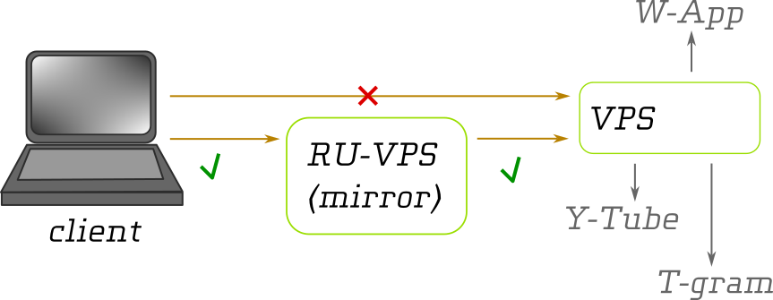

## install-mirror.sh

Скрипт для RHEL- и Debian-подобных систем (Rocky, Alma, CentOS, Ubuntu), создающий «зеркало»
для HTTPS/TLS трафика, а такжа трафика, который маскируется под таковой. Использует Nginx stream, работает с XHTTP-TLS, VLESS-REALITY, Trojan
и, вероятно, с другими подобними протоколами.

### Мотивация

Средства ТСПУ, фильтрующие и блокирущие «неугодный» трафик, обычно имеют мягкие настройки
при соединении российского клиента с серверами в российских датацентрах.
Аналогично, соединение российских серверов (VPS) с зарубежными фильтруется не так жёстко,
как соединение российского клиента с зарубежным VPS. Это даёт шанс обойти цензуру,
используя промежуточный сервер в России.

`install-mirror.sh` позволяет поднять зеркало буквально за 5 минут.

### Детали

Зеркало имеет два IP-адреса (которые **могут совпадать**):

- IP1 — входящий адрес, Nginx слушает его;
- IP2 — исходящий адрес, с которого Nginx отправляет то, что пришло на входящий адрес.

Трафик перенаправляется на ADDRESS, который может быть
задан как IP или как доменное имя.

Перенаправление применяется только для трафика, который выглядит как валидный HTTPS/TLS с заданным полем SNI.
Один веб-сервер может обслуживать несколько сайтов с разными именами, поэтому в поле SNI клиенты указывают,
к какому именно сайту они собираются подключиться (SNI — Server Name). К этому имени также привязывается сертификат
шифрования.

Нужно понимать, что SNI далеко не всегда должно совпадать с ADDRESS. Например, в случае REALITY
используется SNI чужого сайта, в то время как соединение происходит с нашим VPS. В российских реалиях ТСПУ читает
поле SNI, поэтому не стоит использовать зеркало для REALITY с SNI, заданным как "www.microsoft.com" и другими очень
популярными ресурсами, заведомо не располагающимися на российских серверах.

### Поддержать

Подпишись на [телеграм-канал](https://t.me/klein_bottle_vpn) или
купи наш VPN за телеграм-звёзды в [боте](https://t.me/klein_bottle_vpn_bot). Это лучшая поддержка, потому что
помогает не только финансово, но и в тестировании технологий на территории России.

Можно просто пожертвовать телеграм-звёзды в
[том же боте](https://t.me/klein_bottle_vpn_bot) (бот расскажет, как их купить). Техподдержка, контакты которой есть в боте,
может помочь с вопросами по этому скрипту, если такие возникнут.

Для предложений и любой обратной связи анонимно — Matrix/Element `@atom4peace:matrix.org`

TON UQA9zlDMQAvgj4OoYMl0JXNBzpTdprY46pxmm3KY9hQwgKDc

ZEC u1wruwk7r4hxqkcc95wyf5z5d3nxp5hwpzcl6mxa92ddr2yw3mr3wc694w6avhg7qfkg09lg3uj2j522qu56vjrdxcrfm7x072svtk4al5

